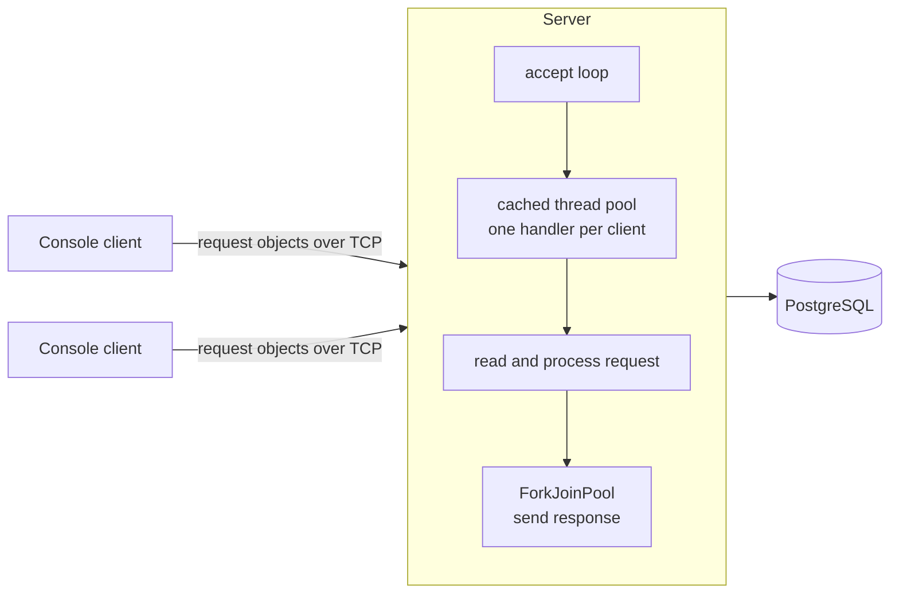

# Study Group Manager

A multi-user client–server application for managing a shared collection of study groups. The
console client talks to a multithreaded TCP server, which keeps the data in PostgreSQL and lets
each user change only their own records.

**Stack:** Java 17 · TCP sockets · Java serialization · `java.util.concurrent` · JDBC · PostgreSQL · Log4j 2 · Maven (multi-module)

## How it works

- **Concurrency.** The server accepts connections in a loop and hands each client to a cached
  thread pool, where requests are read and processed. Responses are written from the common
  ForkJoinPool, so a slow client does not hold up request processing.
- **Protocol.** Clients and server share a `common` module with the models and the
  `CollectionRequest` / `CollectionResponse` messages, sent as serialized objects.
- **Persistence.** DAO classes with prepared statements over JDBC. Every record stores its owner,
  and the server checks ownership before update and delete.
- **Accounts.** Registration and login, passwords stored as hashes.
- **Client.** 17 commands (add, update, remove by id, remove greater or lower, filters, history,
  `execute_script`) and interactive forms with field-level validation.

## Modules

| Module | Contents |
|---|---|
| `common` | Models, request and response types, shared utilities |
| `server` | Socket server, handlers, services, DAO layer |
| `client` | Console UI, commands, field serializers and validators |

The JavaFX desktop client for the same server is in [studygroup-manager-gui](https://github.com/foliageh/studygroup-manager-gui).

---
Built as coursework for the Programming course at ITMO University, 2023.
